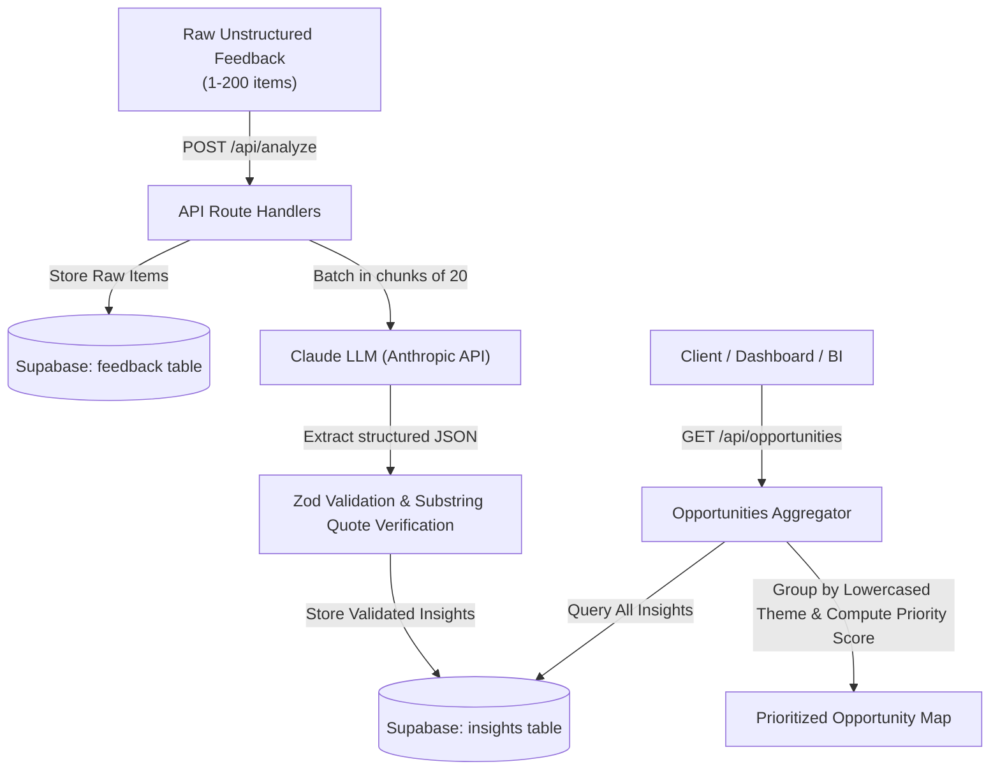

# Feedback to Opportunity Map (Backend)

Turn scattered, unstructured feedback (from students, citizens, product users, or employees) into structured insights, and automatically synthesize them into a prioritized **Opportunity Map** linking recurring themes directly to verbatim evidence.

Built with **Next.js (App Router, TypeScript)**, **Supabase (PostgreSQL)**, and the **Anthropic Claude API**. Backend-only, zero UI overhead, ready to deploy instantly to **Vercel**.

---

## Architecture & Flow



1. **Ingestion & Analysis (`POST /api/analyze`)**:
   - Accepts 1 to 200 raw feedback items with an `audience_type`.
   - Saves raw feedback into Supabase to retain immutable history and obtain UUIDs.
   - Chunks feedback items into batches of 20 and sends them to Claude with an analyst system prompt.
   - Parses the JSON array response (retrying once if API call or parsing fails).
   - Validates every insight object using Zod (coercing urgency to 1–5, validating enums).
   - Verifies quotes against the original input text using lowercase, whitespace-normalized substring matching (`quote_verified = true`).
   - Inserts valid insights into Supabase linked by `feedback_id`.

2. **Opportunity Mapping (`GET /api/opportunities`)**:
   - Reads all insights from Supabase.
   - Groups insights by lowercased `theme` (e.g., `"slow wi-fi"` and `"Slow Wi-Fi"` map to one opportunity).
   - Computes:
     - `mentions`: Total occurrences.
     - `complaints`, `suggestions`, `praise`: Breakdown by feedback type.
     - `avg_urgency`: Average urgency score (1 decimal place).
     - `priority_score`: `mentions * avg_urgency` (set to `0` if a theme consists exclusively of praise).
     - `who_affected`: Up to 5 unique affected groups.
     - `evidence`: Up to 3 quotes with `{feedback_id, quote, verified}`.
   - Sorts opportunities by `priority_score` descending.

---

## Tech Stack & Dependencies

- **Framework**: Next.js 15 (App Router, Serverless Route Handlers)
- **Language**: TypeScript
- **Database**: Supabase (PostgreSQL with Row Level Security bypassed via Service Role Key)
- **AI / LLM**: `@anthropic-ai/sdk` (Claude Sonnet 3.5 / 5.5)
- **Validation**: `zod`
- **Hosting Target**: Vercel (`export const maxDuration = 60`)

---

## Project Structure

```text
.
├── .env.example              # Template for required environment variables
├── package.json              # Project dependencies and npm scripts
├── tsconfig.json             # TypeScript configuration with path alias (@/*)
├── next.config.ts            # Next.js configuration
├── supabase/
│   └── schema.sql            # Database tables, check constraints, and index
├── lib/
│   ├── supabase.ts           # Server-side Supabase client using Service Role key
│   └── analyze.ts            # Claude batching, parsing, retry, validation, quote verification
├── app/
│   └── api/
│       ├── analyze/
│       │   └── route.ts      # POST /api/analyze handler
│       └── opportunities/
│           └── route.ts      # GET /api/opportunities handler
└── README.md                 # Setup, testing, and deployment guide
```

---

## 1. Supabase Database Setup

1. Create a free account and a new project at [supabase.com](https://supabase.com).
2. Open your Supabase project dashboard and navigate to the **SQL Editor** on the left menu.
3. Open `supabase/schema.sql` from this repository, copy its entire contents, and paste them into the SQL Editor:

```sql
-- Table: feedback
create table if not exists feedback (
  id uuid primary key default gen_random_uuid(),
  audience_type text not null,
  text text not null,
  created_at timestamptz default now()
);

-- Table: insights
create table if not exists insights (
  id uuid primary key default gen_random_uuid(),
  feedback_id uuid references feedback(id) on delete cascade,
  theme text,
  category text,
  type text check (type in ('complaint', 'suggestion', 'praise')),
  sentiment text check (sentiment in ('negative', 'neutral', 'positive')),
  urgency int check (urgency between 1 and 5),
  who_affected text,
  evidence_quote text,
  quote_verified boolean default false,
  created_at timestamptz default now()
);

-- Index for fast theme grouping
create index if not exists idx_insights_theme on insights(theme);
```

4. Click **Run** to execute the script and create the tables.
5. In Supabase, go to **Project Settings** -> **API** to retrieve:
   - **Project URL** (e.g., `https://xyzcompany.supabase.co`)
   - **service_role secret** (Found under *Project API keys* - click "Reveal").

---

## 2. Environment Variables Setup

Copy `.env.example` to `.env.local`:

```bash
cp .env.example .env.local
```

Fill in your actual API keys in `.env.local`:

```ini
# Anthropic Claude API Key (from console.anthropic.com)
ANTHROPIC_API_KEY=sk-ant-api03-...

# Claude Model Name (default is claude-sonnet-5-5)
ANTHROPIC_MODEL=claude-sonnet-5-5

# Supabase Project URL
SUPABASE_URL=https://your-project-id.supabase.co

# Supabase Service Role Key (server-side only, bypasses RLS)
SUPABASE_SERVICE_ROLE_KEY=eyJh...
```

> **Security Note**: Never commit `.env.local` to git or expose `SUPABASE_SERVICE_ROLE_KEY` to frontend browsers.

---

## 3. Local Development

### Install Dependencies
```bash
npm install
```

### Run the Development Server
```bash
npm run dev
```

The API endpoints will be accessible at `http://localhost:3000`.

---

## 4. API Documentation & Curl Commands

### Endpoint 1: Analyze Feedback (`POST /api/analyze`)

Ingests an array of raw feedback strings, saves them to the database, processes them through Claude in batches of 20, verifies evidence quotes, and stores the structured insights.

#### Headers
- `Content-Type: application/json`

#### Request Body
- `audience_type` (string, required): Who gave the feedback (e.g., `"students"`, `"citizens"`, `"product users"`).
- `items` (array, 1 to 200 items): List of objects with `text`.

#### Example Request:
```bash
curl -X POST http://localhost:3000/api/analyze \
  -H "Content-Type: application/json" \
  -d '{
    "audience_type": "university students",
    "items": [
      {
        "text": "The Wi-Fi in the Science Library disconnects every 5 minutes during peak study hours. It makes online exams terrifying."
      },
      {
        "text": "The campus shuttle is always 20 minutes late on rainy days, leaving freshmen stranded in the cold."
      },
      {
        "text": "I really love the new 24/7 quiet study pods on the 3rd floor, they are a lifesaver!"
      },
      {
        "text": "The library internet keeps dropping constantly while we try to submit assignments."
      },
      {
        "text": "Could we please add more vegan and gluten-free lunch options in the main dining hall?"
      }
    ]
  }'
```

#### Successful Response (`200 OK`):
```json
{
  "received": 5,
  "insights_created": 5,
  "insights": [
    {
      "id": "52e0be30-050f-4886-b48d-69769da8a50c",
      "feedback_id": "8ca0ea48-8df3-40e0-a7d1-0f46c6a282f6",
      "theme": "Slow Wi-Fi",
      "category": "infrastructure",
      "type": "complaint",
      "sentiment": "negative",
      "urgency": 4,
      "who_affected": "students during peak study hours",
      "evidence_quote": "disconnects every 5 minutes during peak study hours",
      "quote_verified": true,
      "created_at": "2026-10-26T05:30:00.000Z"
    },
    ...
  ]
}
```

#### Error Responses:
- `400 Bad Request`: Payload validation error (e.g., 0 items or >200 items, missing `audience_type`, empty text).
- `502 Bad Gateway`: Anthropic Claude API failed or returned non-JSON output after retry.
- `500 Internal Server Error`: Database insertion failure.

---

### Endpoint 2: Opportunities Map (`GET /api/opportunities`)

Aggregates all insights in the database grouped by lowercased theme, calculates priority scores, identifies affected demographics, and provides verbatim verified quotes.

#### Example Request:
```bash
curl -X GET http://localhost:3000/api/opportunities
```

#### Example Response (`200 OK`):
```json
{
  "total_insights": 5,
  "opportunities": [
    {
      "theme": "Slow Wi-Fi",
      "category": "infrastructure",
      "mentions": 2,
      "complaints": 2,
      "suggestions": 0,
      "praise": 0,
      "avg_urgency": 4.0,
      "priority_score": 8.0,
      "who_affected": [
        "students during peak study hours",
        "students submitting assignments"
      ],
      "evidence": [
        {
          "feedback_id": "8ca0ea48-8df3-40e0-a7d1-0f46c6a282f6",
          "quote": "disconnects every 5 minutes during peak study hours",
          "verified": true
        },
        {
          "feedback_id": "313936aa-0fb8-4ca3-bfa2-fb94e1e35fbb",
          "quote": "internet keeps dropping constantly",
          "verified": true
        }
      ]
    },
    {
      "theme": "Late Campus Shuttle",
      "category": "services",
      "mentions": 1,
      "complaints": 1,
      "suggestions": 0,
      "praise": 0,
      "avg_urgency": 3.0,
      "priority_score": 3.0,
      "who_affected": [
        "freshmen"
      ],
      "evidence": [
        {
          "feedback_id": "1b9f67a2-9fa1-4966-ba09-cd3046755ec5",
          "quote": "always 20 minutes late on rainy days",
          "verified": true
        }
      ]
    },
    {
      "theme": "Dietary Options",
      "category": "services",
      "mentions": 1,
      "complaints": 0,
      "suggestions": 1,
      "praise": 0,
      "avg_urgency": 2.0,
      "priority_score": 2.0,
      "who_affected": [
        "unspecified"
      ],
      "evidence": [
        {
          "feedback_id": "e49fc242-4f36-4ad2-a38f-519fc77c7fce",
          "quote": "more vegan and gluten-free lunch options",
          "verified": true
        }
      ]
    },
    {
      "theme": "24/7 Study Pods",
      "category": "infrastructure",
      "mentions": 1,
      "complaints": 0,
      "suggestions": 0,
      "praise": 1,
      "avg_urgency": 1.0,
      "priority_score": 0.0,
      "who_affected": [
        "unspecified"
      ],
      "evidence": [
        {
          "feedback_id": "78b7a4c7-e3d8-4f51-b847-a7eb2fcb39a3",
          "quote": "new 24/7 quiet study pods on the 3rd floor, they are a lifesaver",
          "verified": true
        }
      ]
    }
  ]
}
```

Notice: Themes that are exclusively praise receive a `priority_score` of `0.0`, allowing teams to focus on complaints and actionable suggestions while preserving positive sentiment insights.

---

## 5. Deploying to Vercel

### Option A: Using the Vercel Dashboard (Recommended)

1. Push this repository to GitHub, GitLab, or Bitbucket.
2. Sign in to [Vercel](https://vercel.com) and click **"Add New..."** -> **"Project"**.
3. Select your repository and click **Import**.
4. In the **Environment Variables** section, add the 4 required variables:
   - `ANTHROPIC_API_KEY`: Your Claude API key.
   - `ANTHROPIC_MODEL`: `claude-sonnet-5-5` (or your preferred Claude model).
   - `SUPABASE_URL`: Your Supabase Project URL.
   - `SUPABASE_SERVICE_ROLE_KEY`: Your Supabase Service Role Secret Key.
5. Click **Deploy**. Vercel will build and deploy the serverless functions.
6. Once deployed, test your live endpoints:
   - `POST https://your-project.vercel.app/api/analyze`
   - `GET https://your-project.vercel.app/api/opportunities`

### Option B: Using the Vercel CLI

1. Install the Vercel CLI globally:
   ```bash
   npm i -g vercel
   ```
2. Log in and deploy:
   ```bash
   vercel
   ```
3. Set the environment variables in your project:
   ```bash
   vercel env add ANTHROPIC_API_KEY
   vercel env add ANTHROPIC_MODEL
   vercel env add SUPABASE_URL
   vercel env add SUPABASE_SERVICE_ROLE_KEY
   ```
4. Deploy to production:
   ```bash
   vercel --prod
   ```

### Serverless Execution Timeout
`app/api/analyze/route.ts` specifies:
```typescript
export const maxDuration = 60;
```
This configures Vercel to allow up to 60 seconds of execution time, providing ample headroom for processing batches of up to 200 items with Claude.
